<div align="center">



**Wasibul Islam Wasib** · Born May 11, 2006


Student. Builder. Experimenter — the code talks for me.

<a href="https://wasib-2005.github.io/Portfolio/"></a>
<a href="mailto:wasibulislam8984@gmail.com"></a>

<a href="https://www.linkedin.com/in/wasib2005"></a>
<a href="https://wa.me/8801855005875"></a>

</div>

<br>

 cat about.txt" /><br>


```
Name      :  Wasibul Islam Wasib
Role      :  Full-Stack Web Developer (MERN)
Stack     :  MongoDB · Express · React · Node.js · Vite
Study     :  Computer Science & Technology · Munshiganj Polytechnic
Interests :  Networking · Anime · Manga · Web Series
Style     :  Build alone. Ship clean. Talk less.
Status    :  Student · Always experimenting
```

<br>

 ls ./stack" /><br>


<div align="center">

### 💻 Languages


### ⚡ Frameworks & Database


### 🔧 Tools


</div>

<br>

 neofetch" /><br>


<div align="center">

<a href="https://github.com/Wasib-2005"></a>
<a href="https://github.com/Wasib-2005"></a>

<a href="https://github.com/Wasib-2005"></a>

</div>

<br>

 cat roadmap.md" /><br>


```
NOW    →  MERN · TypeScript · Networking
NEXT   →  Python deep-dive · Data fundamentals
SOON   →  ML basics · real projects
GOAL   →  Build intelligent systems
```

<br>

 cat hobbies.log" /><br>


```
Anime          always got something running
Manga          panels hit different at 2am
Web Series     binge mode: on
Gaming         Mobile Legends · Genshin · GTA V · Forza
```

<br>

 contact --reach-me" /><br>


```
Email     :  wasibulislam8984@gmail.com
WhatsApp  :  +880 1855-005875
LinkedIn  :  linkedin.com/in/wasib2005
Portfolio :  https://wasib-2005.github.io/Portfolio/
Open to   :  Collabs · Projects · Interesting problems
```

<div align="center">


</div>